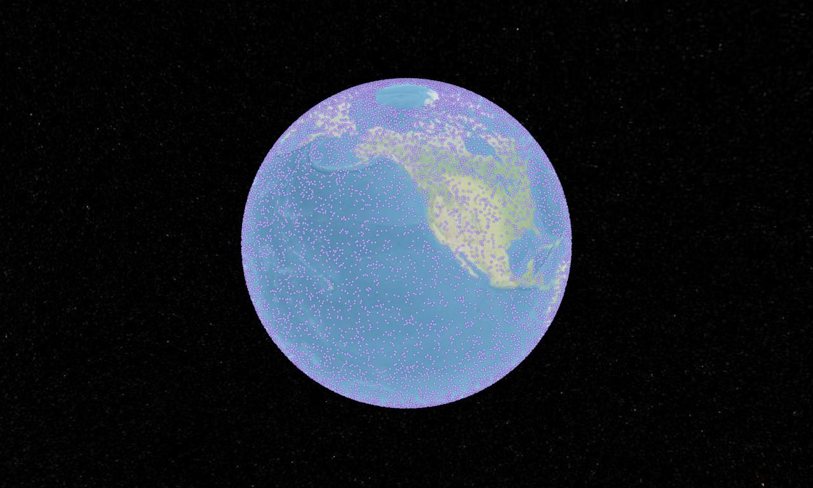

# Spike result — CesiumJS in a Tauri 2 WebView (macOS / WKWebView)

- Date: 2026-10-11
- Code: `spikes/tauri-cesium/` (throwaway; see its README to rerun)
- Machine: Apple M3 Pro, macOS 27.2, external 2560×1440 display + built-in Retina
- Versions: Tauri 2.12.0 (`tauri`), `@tauri-apps/api` 2.12.0, `@cesium/engine` 26.3.0 (CesiumJS 1.145), Vite 8.3.1, TypeScript 7.0.2

## Question

Can Lavender's planned frontend stack (Vite + `@cesium/engine` without Cesium's
Knockout widgets) render the globe inside Tauri's WebView under a strict
Content-Security-Policy? Do Cesium's web workers, WASM decoders and static assets
resolve over the `tauri://localhost` scheme? Do Tauri commands and channels carry
data both ways at feed rates?

## Method

The page reports its own measurements over IPC, so nothing depends on
eyeballing a window: widget creation time, time to first full tile load, frames
during 3 s of camera rotation, worker-built geometry readiness, lit-pixel ratio
of a canvas capture, `securitypolicyviolation` events, uncaught errors, and IPC
round-trips. Rust writes `report.json` and `globe.png`.

## Result (final run)

| Measurement | Value |
|---|---|
| WebGL | WebGL2, renderer "Apple GPU", `MAX_TEXTURE_SIZE` 16384 |
| `CesiumWidget` construction | 186 ms |
| First full tile load (bundled NaturalEarthII, offline) | 1 808 ms |
| Motion frame rate, 20 000 `PointPrimitiveCollection` points, rotating | 72 fps (217 frames / 3 s) |
| Worker-built `PolygonGeometry` | ready |
| Uncaught errors | none |
| Tauri command (`spike_core_info`, stand-in for a shared-core call) | OK |
| Tauri `Channel`: 200 messages | 200 received, in order, 12 ms |
| CSP violations | none with the final policy below (with `style-src 'self'` alone: `style-src-elem` + `style-src-attr` inline, see finding 3) |



## Findings that change the design

1. **Cesium assets must be copied from two places.** `@cesium/engine` 26.x ships
   `Build/Workers` and `Build/ThirdParty`, but `Assets` (imagery, IAU2006 tables,
   `approximateTerrainHeights.json`) only under `Source/Assets`. Missing assets do
   not 404 under `tauri://`. The asset handler falls back to `index.html`, so
   Cesium hit `JSON Parse error: Unrecognized token '<'` inside the render loop.
   The default render loop **stops on the first render error**, so the globe froze
   at 0 fps. The frontend's asset step must fail the build when a required Cesium
   directory is missing. Lavender must also install a render-error handler that
   reports instead of freezing silently.
2. **`'wasm-unsafe-eval'` is required; `'unsafe-eval'` is not.** Cesium compiles
   WebAssembly (Draco/Basis decoders, splat WASM) on the main thread and in
   workers. Without Widgets/Knockout no JavaScript `eval` is needed. GEV's CSP
   needed full `'unsafe-eval'` because it used the Widgets `Viewer`.
   Lavender's script policy is `script-src 'self' 'wasm-unsafe-eval'`.
3. **Cesium's `CreditDisplay` injects inline styles.** It appends a static
   `<style>` element (`Source/Scene/CreditDisplay.js:305`) and an inline `style`
   attribute on the ion logo. The options are to allow `style-src 'unsafe-inline'`,
   or to pin the static stylesheet by hash plus `'unsafe-hashes'` for the
   attribute. Style injection cannot execute script. Lavender starts with
   `style-src 'self' 'unsafe-inline'`, with a hardening task to move to hashes.
   **Verified:** with `'unsafe-inline'` added the run had zero violations. Caveat
   (CSP Level 3): if Tauri injects a hash or nonce into `style-src`, browsers
   *ignore* `'unsafe-inline'`. Tauri hashes inline `<style>` blocks it finds in
   the HTML, so `index.html` must contain no inline styles. Alternatively, set
   `app.security.dangerousDisableAssetCspModification: ["style-src"]`. A test
   asserts the built `index.html` has no inline `<style>` or `style=`.
4. **A plain `cargo build` of a Tauri app is a dev build.** Without the
   `tauri/custom-protocol` feature the WebView loads `build.devUrl`. The desktop
   crate's release target must pass the feature or use `cargo tauri build`.
5. **WKWebView pauses `requestAnimationFrame` for occluded windows.** It saves
   power and is fine for Lavender, but any timing measurement must be wall-clock
   bounded, and live-feed processing must not depend on the render loop.
6. **Tauri's CSP rewriting works with Vite output.** Tauri added its own script
   hashes to `script-src` (visible in an error message) and the Vite module
   bundle loaded under `'self'`.
7. **Agent sandbox note (environment, not product).** The GUI binary cannot open
   a window from inside the coding agent's sandboxed shell; the runs above were
   executed outside it.

## Final policy used

```text
default-src 'self'; script-src 'self' 'wasm-unsafe-eval'; style-src 'self' 'unsafe-inline';
img-src 'self' data: blob:; connect-src 'self' ipc: http://ipc.localhost; worker-src 'self' blob:;
object-src 'none'; base-uri 'self'; frame-ancestors 'none'
```

Production adds the catalog's tile hosts to `img-src`/`connect-src` (ADR 0008).

## Not covered

- **Windows (WebView2) and Linux (WebKitGTK).** Not available on this machine.
  WebKitGTK is the highest-risk engine for WebGL2 (GPU/DMA-BUF compositing
  issues). See `docs/architecture/tauri.md` for the CI matrix and mitigations.
- Remote imagery and terrain over `https:` from `tauri://`, and 3D Tiles.
  Covered by the end-to-end desktop task against the real frontend.
- GPU memory pressure with large imagery and terrain caches.
