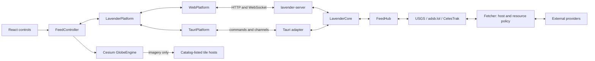

# Architecture Explained Simply

The frontend describes what the analyst wants to see. The Rust core fetches and
validates the records, shares upstream work between viewers, and returns typed
snapshots. The HTTP server and desktop command handler translate requests into
calls to that same core. Cesium draws the resulting records.

## Responsibilities

| Component | What it owns | Boundary |
|---|---|---|
| [Frontend runtime](../../apps/web/src/runtime/createRuntime.ts) | Starts catalog/status loading, state, preferences and the feed controller. | React screens use the runtime and platform interface; they do not implement provider networking. |
| [FeedController](../../apps/web/src/feeds/FeedController.ts) | Subscriptions for enabled layers, viewport changes, feed summaries and selected records. | Sends records to the globe outside React's render cycle. |
| [HTTP adapter](../../crates/lavender-server/src/routes.rs) and [stream](../../crates/lavender-server/src/ws.rs) | Request decoding, budgets, HTTP errors, ETags and WebSocket frames. | Provider logic stays in the core; this adapter serves built static files too. |
| [LavenderCore](../../crates/lavender-core/src/core.rs) | Builds providers, checks availability, exposes snapshots, subscriptions, search and tracks. | Has no Axum or Tauri dependency. |
| [FeedHub](../../crates/lavender-core/src/hub.rs) | One refresh task per feed/region, latest results, filters, capacity and cancellation. | A provider never schedules a task per viewer. |
| [Providers](../../crates/lavender-core/src/providers/) | Fetch source documents and normalize them into validated entity types. | Do not create HTTP responses or draw entities. |
| [Fetcher](../../crates/lavender-core/src/fetch.rs) | Host allowlists, HTTPS, redirects, time/body bounds, pacing, retries and cancellation. | Requests are built by provider code, never from an arbitrary browser URL. |
| [Domain](../../crates/lavender-domain/src/lib.rs) | Serializable contract types and validation, generated TypeScript. | No networking or runtime dependency. |
| [Geo](../../crates/lavender-geo/src/lib.rs) | Coordinates, cells, distances, indexes and orbital calculations. | Pure computations; no file or network access. |
| [GlobeEngine](../../apps/web/src/globe/GlobeEngine.ts) | Cesium lifecycle, imagery, camera, picking and renderers. | React owns controls; Rust owns feed ingestion. |

Four crates plus a desktop binary are sufficient for these boundaries. Domain
and geo are separately testable without networking; core has two real transport
consumers. There is no additional provider/service crate per source.

## An aircraft record end to end

1. The layer store changes when Aircraft is enabled. `FeedController.#reconcile`
   calls `LavenderPlatform.subscribe` with a `FeedQuery`. Viewport updates are
   debounced for 300 ms.
2. [`WebPlatform`](../../apps/web/src/platform/web/WebPlatform.ts) sends a
   `ClientFrame::Subscribe` over `/api/v1/stream`. Polling fallback uses
   `GET /api/v1/feeds/aircraft` with the same query.
3. `ws::Connection::subscribe` checks subscription limits and calls
   `LavenderCore::subscribe_with_budget`. The core checks source configuration and
   licence availability, then asks the hub to subscribe.
4. [`hub/slots.rs`](../../crates/lavender-core/src/hub/slots.rs) plans cells and
   leases a shared refresh slot for each. Overlapping queries share slots. If the
   view exceeds the aircraft cell limit, the provider's global fallback is used,
   with a partial-coverage notice.
5. [`hub/refresh.rs`](../../crates/lavender-core/src/hub/refresh.rs) calls
   `AdsbLolProvider::fetch`. [`adsb_lol.rs`](../../crates/lavender-core/src/providers/adsb_lol.rs)
   creates the point/radius URL or `/v2/mil`, then calls `Fetcher::get`.
6. `adsb_lol::parse` reads rows independently. `normalize_aircraft` validates the
   transponder address and position, trims text, preserves feet in aviation fields,
   and converts the position altitude to metres. Invalid rows are counted and
   skipped, rather than losing all valid aircraft.
7. [`hub/snapshot.rs`](../../crates/lavender-core/src/hub/snapshot.rs) merges region
   results, deduplicates by hex, applies viewport/military filters, caps items and
   judges freshness. [`hub/subscription.rs`](../../crates/lavender-core/src/hub/subscription.rs)
   publishes the newest snapshot and reacts to query changes or cancellation.
8. The stream forwarder serializes a `ServerFrame::Snapshot`. `WebPlatform`
   delivers a feed event; `FeedController.#onEvent` updates summaries and calls
   `GlobeEngine.applySnapshot`. The
   [aircraft renderer](../../apps/web/src/globe/renderers/aircraft.ts) updates
   existing primitives by key instead of rebuilding the layer.

On desktop, steps 2–3 use a Tauri command/channel and
[`commands.rs`](../../apps/desktop/src-tauri/src/commands.rs). Steps 4–7 are identical.

## Caches, errors and state

Hub slots hold the latest records in memory and linger briefly after their last
viewer leaves. CelesTrak additionally caches group documents in memory and on disk;
its two-hour download cadence and retry floor are provider requirements. Cache
reuse preserves the original download time. There is no general database or
custom cache framework to learn.

Provider errors are cleaned and capped before reaching health and snapshots.
Failed refreshes retain existing records with degraded freshness. Without usable
records, a snapshot can report unavailable freshness. Invalid queries and limits
are `CoreError` values converted to `ApiError`; the HTTP adapter chooses an HTTP
status, and desktop returns the same error shape. Read both the error envelope
and freshness/coverage: HTTP 200 alone does not mean complete, current data.

Dropping a subscription cancels its task and releases its region leases. Resource
budgets, bounded queues and cancellation guards protect all viewers and are
necessary parts of the shared core. See [Testing and Debugging](testing.md) for
checks that preserve these guarantees.
